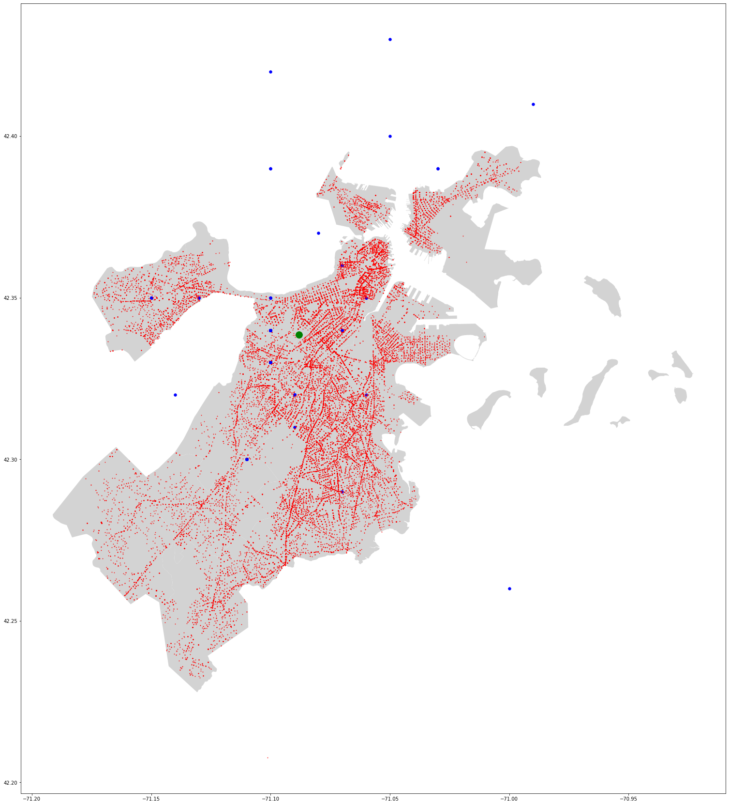

# RedEye Service Analysis: Radius Optimization

**Is Northeastern's RedEye night escort reaching the students who need it? A geospatial look at student residences, 2022 Boston crime incidents and MBTA reliability, with recommendations to expand the service radius.**


<p align="center">
  
</p>
<p align="center"><sub>2022 crime incidents (red), surveyed student residences (blue) and Snell Library (green)</sub></p>

## Overview

RedEye is Northeastern University's off-campus safety escort. It runs from 5 pm to 6 am for students who live within **2 miles of Snell Library**. We evaluated how well the service works, how accessible it is, how safe students feel commuting at night, and which alternatives they use. The goal was evidence the university could use when planning changes to campus transportation.

## Data sources

| Source | Type | Use |
| --- | --- | --- |
| Student survey (114 responses, about 80% graduate students) | Primary | Awareness, usage, commute frequency and times, perceived safety |
| [Analyze Boston: crime incident reports](https://data.boston.gov/dataset/crime-incident-reports-august-2015-to-date-source-new-system) (2022) | Public | Crime around student residences during commute hours |
| [MBTA customer satisfaction and prediction accuracy](https://mbta-massdot.opendata.arcgis.com/) | Public | Reliability of the most common alternative commute |

## Key findings

- **Awareness gap:** about **15%** of students had never heard of RedEye. They were mostly graduate students, who often stay on campus late and travel to campus more often.
- **Safety:** only **49%** of students feel safe leaving campus after 5 pm. Many student residences sit inside high-incident areas (Roxbury, South End and Mission Hill), and Roxbury had the most incidents.
- **Frequency matters:** students who commute at night once a week were mostly unaffected. Students who commute more often were increasingly affected by the limited options, and most supported widening the 2-mile radius.
- **Alternatives:** after walking, the MBTA is the most common alternative, and Uber or a car is preferred late at night. MBTA dissatisfaction rose steadily from July, driven by delays, unreliable on-time performance and poor communication.

## Recommendations

1. **Expand the 2-mile radius** to cover the high-crime neighborhoods where students live.
2. **Integrate RedEye into the Transit app**, with Northeastern single sign-on and live vehicle tracking, so students can compare options in one place.
3. **Run targeted awareness campaigns** for graduate students.
4. **Use RedEye trip data** (trip volume, peak times and durations) and run a student version of the MBTA satisfaction survey to refine service hours and fleet size.

## Approach

- Geocoded survey ZIP codes to coordinates with `uszipcode`, and fixed invalid ZIP codes and outliers.
- Cleaned the crime data: removed invalid reports and records without coordinates, and reviewed 119 offense types.
- Computed the geodesic distance from each student residence to the nearest incident.
- Mapped residences, incidents and Snell Library over the Boston neighborhoods shapefile with GeoPandas.

## Repository structure

```
├── assets/                          README images
├── data/                            input files go here (not committed)
├── notebooks/
│   └── redeye_analysis.ipynb        wrangling, distance analysis and maps
├── reports/
│   ├── redeye_final_report.pdf
│   └── redeye_presentation.pdf
└── requirements.txt
```

## Getting started

The notebook was built in Google Colab and uploads its inputs at runtime.

1. Open `notebooks/redeye_analysis.ipynb` in [Colab](https://colab.research.google.com/) (File → Upload notebook) or Jupyter.
2. Provide the input files listed in [data/README.md](data/README.md).
3. Run all cells. Outside Colab, install the dependencies first with `pip install -r requirements.txt` and replace the `google.colab` upload cells with local paths.

## Team

Team project at Northeastern University, presented as *Empty Duck Consulting* (Fall 2022).
